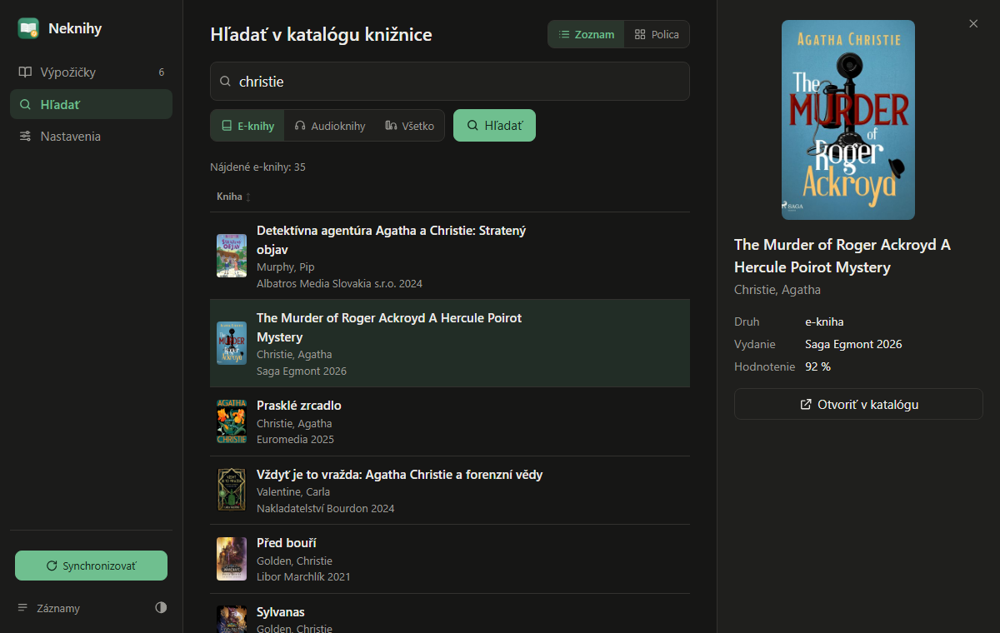

# Neknihy NextGen

Neknihy NextGen manages e-book and audiobook loans from Czech and Slovak
libraries that lend through Palmknihy. It downloads borrowed books, copies
them to your e-reader (or a Calibre-Web ingest folder), files audiobooks
for Audiobookshelf and returns loans with one click. It runs as a desktop
app or headless in Docker with a web interface in Czech, Slovak, English
and German. The documentation below is in Slovak.

Neknihy NextGen spravuje výpožičky e-kníh a audiokníh z knižníc, ktoré
požičiavajú cez Palmknihy:

- stiahne vypožičané e-knihy aj audioknihy a synchronizuje ich s čítačkou
  alebo s ingest priečinkom Calibre-Web,
- audioknihy ukladá ako `Autor/Názov`, takže sa hodia pre Audiobookshelf,
- vyhľadá a vypožičia knihy priamo z katalógu knižnice (katalog.tsk.sk),
- výpožičky vracia jedným tlačidlom a prepadnuté knihy zmaže aj z čítačky,
- beží ako desktopová aplikácia alebo v Dockeri (napr. na NAS)
  s webovým rozhraním a automatickým obnovovaním v nastavenom intervale.

Projekt vychádza z pôvodných [Neknihy](https://github.com/thalman/neknihy)
od Tomáša Halmana.

## Motivácia

Niektoré knižnice v ČR a SR požičiavajú aj e-knihy a audioknihy, čo je skvelé. Žiaľ,
mobilná aplikácia na čítanie nemá veľmi dobré hodnotenie a na veľkom
množstve čítačiek nefunguje dobre alebo vôbec.

Knihy sa dajú po uplynutí výpožičnej doby jednoducho vrátiť priamo
tlačidlom v aplikácii. Pri ďalšej synchronizácii s čítačkou sa knihy
zmažú aj z čítačky.

Účelom aplikácie nie je nekalé kopírovanie, ale umožniť
ľuďom plnohodnotný čitateľský zážitok a komfort.

## Inštalácia

Neknihy NextGen zatiaľ nemajú vlastné inštalačné balíčky. Balíčky
v [Releases pôvodného projektu](https://github.com/thalman/neknihy/releases)
obsahujú pôvodné Neknihy bez noviniek z NextGen (webové rozhranie, katalóg
knižnice, audioknihy). Odporúčaný spôsob je Docker Compose, desktopovú
aplikáciu spustíte zo zdrojových kódov (pozri nižšie).

### Docker Compose (odporúčané)

Hotový obraz `ghcr.io/misko903/neknihy:latest` (amd64 aj arm64, teda aj
Raspberry Pi a väčšina NAS) sa zostavuje automaticky z vetvy `main`.

1. Vytvorte priečinok, napr. `neknihy`, a v ňom súbor `docker-compose.yml`:

    ```yaml
    services:
      neknihy:
        image: ghcr.io/misko903/neknihy:latest
        container_name: neknihy
        restart: unless-stopped
        user: "1000:1000"                 # vaše UID:GID (príkaz `id`)
        ports:
          - "8478:8478"
        environment:
          TZ: "Europe/Bratislava"
          NEKNIHY_WEB_PASSWORD: "zmen-ma" # heslo do webového rozhrania
        volumes:
          - ./config:/config              # nastavenia
          - ./books:/books                # stiahnuté knihy
          # - /cesta/k/audiobookshelf:/audiobooks
          # - /cesta/k/calibre-web/ingest:/reader
    ```

2. Vytvorte priečinky pre dáta a spustite kontajner:

    ```bash
    mkdir -p config books
    docker compose up -d
    ```

3. Otvorte `http://<adresa-servera>:8478`, prihláste sa ľubovoľným menom
   a heslom z `NEKNIHY_WEB_PASSWORD` a v Nastaveniach zadajte e-mail a heslo
   Palmknihy (prípadne aj prihlásenie do katalógu knižnice).

Aktualizácia na novú verziu:

```bash
docker compose pull && docker compose up -d
```

Podrobnejší príklad so všetkými voľbami (aj pre Synology Container Manager)
je v [docker-compose.yml](docker-compose.yml) v tomto repozitári. Ten obraz
zostavuje priamo z GitHubu, takže nepotrebuje register.

## Headless / Docker

Neknihy sa dajú spustiť aj bez desktopového GUI, napríklad v Dockeri na NAS.
Kontajner obsahuje jednoduché webové rozhranie (predvolený port `8478`), kde
zadáte prihlasovacie údaje, vidíte výpožičky a môžete ručne spustiť
obnovenie, stiahnutie, synchronizáciu alebo zmazanie prepadnutých výpožičiek.
V nastavenom intervale (predvolene 6 h) beží všetko automaticky.

Nastavenia z webu sa ukladajú do `/config` (heslo k Palmknihy v čitateľnej
podobe, rovnako ako pri desktopovej verzii). Webové rozhranie chráňte heslom
(`NEKNIHY_WEB_PASSWORD`) a nevystavujte ho do internetu.

| Premenná | Predvolená | Popis |
|---|---|---|
| `NEKNIHY_WEB_PORT` | `8478` | port webového rozhrania |
| `NEKNIHY_WEB_PASSWORD` | – | heslo do webového rozhrania (ľubovoľné meno) |
| `NEKNIHY_LANG` | – | predvolený jazyk webu (`cs`, `sk`, `en`, `de`); inak podľa prehliadača, záložne čeština. Každý prehliadač si jazyk môže zmeniť v Nastaveniach (vrátane voľby „Automaticky (podľa prehliadača)“) |
| `NEKNIHY_CONFIG_DIR` | `/config` | priečinok pre nastavenia |
| `NEKNIHY_EMAIL` | – | počiatočný e-mail Palmknihy |
| `NEKNIHY_PASSWORD` | – | počiatočné heslo Palmknihy |
| `NEKNIHY_WORKDIR` | `/books` | priečinok pre stiahnuté knihy |
| `NEKNIHY_READERDIR` | – | voliteľný priečinok na synchronizáciu |
| `NEKNIHY_AUDIODIR` | – | priečinok pre audioknihy, napr. knižnica Audiobookshelf; audioknihy sa ukladajú ako `Autor/Názov/` (kapitoly MP3) a do priečinka sa presunú až celé stiahnuté. Ak nie je nastavený a v kontajneri existuje `/audiobooks`, použije sa ten. Prázdne = priečinok pre knihy |
| `NEKNIHY_INTERVAL` | `21600` | počiatočný interval v sekundách, `0` = vypnuté |
| `NEKNIHY_AUTO_RETURN` | `1` | mazať súbory prepadnutých výpožičiek |
| `NEKNIHY_INGEST` | `0` | `1` = priečinok na synchronizáciu je ingest priečinok Calibre-Web Automated / NextGen; každá kniha sa doň skopíruje len raz |
| `NEKNIHY_CONVERT` | `0` | prevod na .mobi (vyžaduje Calibre, v obraze nie je) |
| `NEKNIHY_DEBUG` | `0` | výpis HTTP komunikácie |
| `NEKNIHY_TSK_USERNAME` | – | počiatočné prihlásenie do katalógu knižnice (katalog.tsk.sk) |
| `NEKNIHY_TSK_PASSWORD` | – | počiatočné heslo do katalógu knižnice |
| `NEKNIHY_TSK_LIBRARY` | `vkmr` | kód knižnice z adresy katalógu (`katalog.tsk.sk/library/<kód>/`) |

Hodnoty `NEKNIHY_EMAIL` … `NEKNIHY_AUTO_RETURN` a `NEKNIHY_TSK_*` slúžia len
ako počiatočné, ďalej platí to, čo uložíte vo webovom rozhraní.

### Požičiavanie z katalógu knižnice (katalog.tsk.sk)

Knižnice Trenčianskeho samosprávneho kraja (napr. VKMR Trenčín) požičiavajú
e-knihy Palmknihy cez svoj online katalóg. Na hlavnej stránke je pole
„Hľadať a požičať e-knihu“: zadajte názov, autora alebo ISBN a Neknihy zobrazia
e-knihy z katalógu (hľadanie nevyžaduje prihlásenie). Po vyplnení prihlásenia
do katalógu v nastaveniach má každá kniha tlačidlo „Požičať“; Neknihy ju vypožičajú
a hneď stiahnu z Palmknihy (a prípadne synchronizujú). Knihy, ktoré už máte
vypožičané, sú vo výsledkoch označené. Namiesto hľadania sa dá vložiť aj odkaz
na knihu v katalógu alebo jej ID diela (`workId`).

Z príkazového riadka:
`python3 src/neknihy_cli.py --search poirot` (vypíše `workId` nájdených e-kníh),
`NEKNIHY_TSK_USERNAME=... NEKNIHY_TSK_PASSWORD=... NEKNIHY_EMAIL=... NEKNIHY_PASSWORD=... python3 src/neknihy_cli.py --borrow 1439847`

Webové rozhranie je v češtine, slovenčine, angličtine a nemčine. Jazyk sa
vyberá podľa prehliadača a dá sa prepnúť v záhlaví stránky. Preklady sú
v `src/neknihy/locales/*.json`; nový jazyk pridáte skopírovaním `en.json`
pod kódom jazyka (napr. `pl.json`) a preložením hodnôt. Chýbajúce texty sa
zobrazia po anglicky. Kontrola prekladov: `python3 -m unittest discover tests`.

Jednorazovo bez webu (napr. z cronu):
`NEKNIHY_EMAIL=... NEKNIHY_PASSWORD=... python3 src/neknihy_cli.py --once --workdir ~/knihy`

## Snímka obrazovky



## Podpora mobi a Kindle

Ak máte nainštalovanú aplikáciu [Calibre](https://calibre-ebook.com/),
Neknihy môžu vypožičanú publikáciu automaticky previesť do formátu `mobi`.
V desktopovej aplikácii v záložke `Nastavení` zaškrtnite voľbu
`Převádět .epub na .mobi (pro Kindle)` a vyplňte cestu k programu
`ebook-convert` (súčasť Calibre). V Dockeri na to slúži `NEKNIHY_CONVERT`,
Calibre však v obraze nie je.

### Cesta k programu `ebook-convert` pre macOS

    /Applications/calibre.app/Contents/MacOS/ebook-convert

## Inštalácia zo zdrojových kódov

Zdrojové kódy získate cez git:

    git clone https://github.com/misko903/neknihy.git

alebo ako [zip archív vetvy main](https://github.com/misko903/neknihy/archive/refs/heads/main.zip)
(rozbalí sa do priečinka `neknihy-main`). V príkladoch nižšie je priečinok
so zdrojákmi `neknihy`.

Desktopová aplikácia (`src/neknihy.py`) je pôvodné okno Neknihy v češtine;
webové rozhranie spustíte aj bez Dockeru príkazom
`NEKNIHY_CONFIG_DIR=~/.config/neknihy-web NEKNIHY_WORKDIR=~/knihy python3 src/neknihy_web.py`
(potom http://localhost:8478).

### Linux

Nainštalujte python3 z distribúcie, doinštalujte závislosti a spustite
aplikáciu. Príklad pre Fedora Linux:

    sudo dnf install python3 python3-requests python3-gobject
    ./neknihy/src/neknihy.py

Príklad inštalácie s python virtual environment

    sudo dnf install python3
    cd ./neknihy
    python -m venv venv
    source venv/bin/activate
    pip install -r src/REQUIREMENTS.txt
    ./src/neknihy.py

Ak máte problémy s inštaláciou `PyGObject`, použite namiesto neho
`platformdirs` (`pip install platformdirs`)

### Windows

Aplikácia na svoj beh potrebuje Python, stiahnite si a nainštalujte
[Python z oficiálneho zdroja](https://www.python.org/downloads/windows/).
Pri inštalácii vyberte voľbu "add python.exe to PATH".

Spustite si príkazový riadok (cmd) a presvedčte sa, že Python je správne
nainštalovaný a dá sa spustiť

    c:\...> python --version
    Python 3.11.6

Stiahnite si [zdrojové kódy](https://github.com/misko903/neknihy/archive/refs/heads/main.zip)
a rozbaľte ich na disk. V príkazovom
riadku doinštalujte potrebné závislosti. Voliteľne môžete zmeniť príponu
súboru z .py na .pyw:

    c:\...> cd .....\neknihy\src
    c:\...> python -m pip install -r REQUIREMENTS.txt
    c:\...> copy neknihy.py neknihy.pyw

Aplikácia je pripravená na použitie, spustíte ju dvojklikom na súbor neknihy.py alebo
neknihy.pyw

### macOS (s procesormi Intel aj Apple Silicon (M1 a novšie))

Stiahnite si zdrojové kódy (pozri vyššie). Nainštalujte python3 a knižnicu Tkinter. Doinštalujte závislosti a spustite aplikáciu.

#### Príklad inštalácie cez Homebrew

    brew install python3
    brew install python-tk
    ./neknihy/src/neknihy.py

#### Príklad inštalácie cez Homebrew a python virtual environment

    brew install python3
    brew install python-tk
    cd ./neknihy
    python -m venv venv
    source venv/bin/activate
    pip install -r src/REQUIREMENTS.txt
    ./src/neknihy.py
